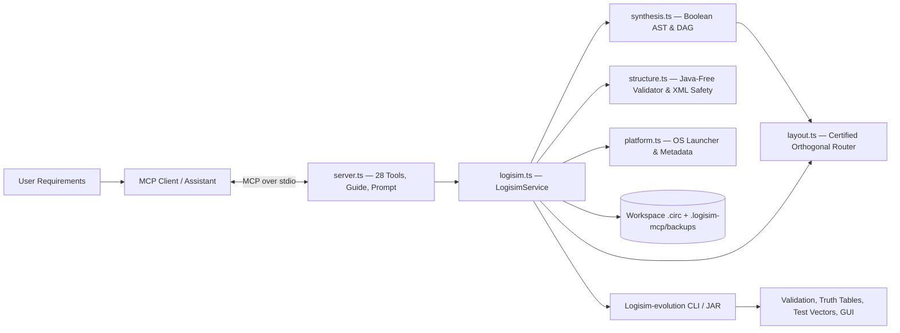

# Logisim-evolution Unified MCP Server

A cross-platform (**Windows**, **macOS**, **Linux**) local Model Context Protocol (MCP) server for creating, inspecting, synthesizing, routing, validating, simulating, and opening native **Logisim-evolution** `.circ` digital logic projects.

This repository unifies:
- **Certified layout, orthogonal routing, and guarded write validation** (`afishyke/Logisim-Evolution-MCP-Server`): A* crossing-free orthogonal router with geometry certificates, source-verified component footprints (gates, sequential/memory parts, arithmetic, splitters, pins, clocks, LEDs), per-project file locks, atomic writes with `.logisim-mcp/backups/` snapshots, Logisim CLI normalization round-trip checks, truth-table/test-bench execution, format conversion, and GUI launch.
- **Boolean synthesis, anchor-based editing, raw XML I/O, and cross-platform JAR/EXE support** (`Irfan-1506/logisim_mcp`): AST-based Boolean expression synthesis (`logisim_synthesize_logic`) with constant folding, common-subexpression sharing, and `"auto"` / `"wires"` / `"tunnels"` layout modes; 10 ready-to-verify examples (`logisim_create_example`); raw XML read/import (`logisim_read_xml`, `logisim_import_xml`); fast Java-free structural validation (`logisim_check_structure`); anchor-addressed batch edits with SHA256 optimistic concurrency (`logisim_edit_project`); inline test-vector execution (`logisim_run_test_vectors`); plus the `logisim://guide` resource and `design_circuit` prompt.

---

## Features

- **28 MCP Tools** covering the full digital-logic design lifecycle:
  - **Discovery & Inspection:** `logisim_get_status`, `logisim_describe_component`, `logisim_list_projects`, `logisim_inspect_project`, `logisim_read_xml`
  - **Project & Circuit Management:** `logisim_create_project`, `logisim_import_xml`, `logisim_copy_circuit`, `logisim_add_circuit`, `logisim_set_main_circuit`
  - **Index-Addressed Edits:** `logisim_add_component`, `logisim_update_component`, `logisim_remove_component`, `logisim_add_wire`, `logisim_remove_wire`, `logisim_apply_batch`
  - **Anchor-Addressed Edits (with SHA256 concurrency):** `logisim_edit_project`
  - **Boolean Synthesis & Certified Routing:** `logisim_synthesize_logic`, `logisim_create_example`, `logisim_layout_graph`
  - **Validation, Simulation & GUI:** `logisim_check_structure`, `logisim_validate_project`, `logisim_truth_table`, `logisim_run_test_vectors`, `logisim_test_vector`, `logisim_test_bench`, `logisim_convert_project`, `logisim_launch_gui`
- **MCP Resource & Prompt:** `logisim://guide` workflow reference and `design_circuit` prompt.
- **Cross-Platform Launcher Detection:** Works with native launchers (`LOGISIM_EXECUTABLE`), JAR files (`LOGISIM_JAR` + `LOGISIM_JAVA`/`java`), or automatic detection of standard Windows, macOS, and Linux installations. Supports Logisim-evolution **3.8.x** and **4.0.0+**.

---

## Installation

### Prerequisites

- **Node.js 22 or later** (`node --version`)
- **Logisim-evolution 3.8.x or 4.0.0+** (optional if you only need XML generation/structural checks; required for CLI validation, truth tables, test vectors, test benches, format conversion, and GUI launch)
- **Java 17+** (required if running Logisim-evolution via `.jar` rather than its bundled native launcher)

### 1. Clone and Build

#### Windows (PowerShell)

```powershell
git clone https://github.com/Irfan-1506/logisim_mcp.git
cd logisim_mcp
npm install
npm run build
```

#### macOS / Linux (bash / zsh)

```bash
git clone https://github.com/Irfan-1506/logisim_mcp.git
cd logisim_mcp
npm install
npm run build
```

### 2. Install / Locate Logisim-evolution

The server automatically checks standard installation paths if neither `LOGISIM_EXECUTABLE` nor `LOGISIM_JAR` is set:

| OS | Auto-Detected Native Launcher | Auto-Detected JAR Location |
| --- | --- | --- |
| **Windows** | `C:\Program Files\logisim-evolution\logisim-evolution.exe` (also checks `ProgramFiles(x86)` and `%LOCALAPPDATA%\Programs`) | `C:\Program Files\logisim-evolution\app\logisim-evolution-*.jar` |
| **macOS** | `/Applications/Logisim-evolution.app/Contents/MacOS/Logisim-evolution` (also checks `~/Applications`) | `/Applications/Logisim-evolution.app/Contents/app/logisim-evolution-*.jar` |
| **Linux** | `/opt/logisim-evolution/bin/logisim-evolution`, `/usr/bin/logisim-evolution`, `/usr/local/bin/logisim-evolution` | `/opt/logisim-evolution/lib/app/logisim-evolution-*.jar`, `/opt/logisim-evolution/lib/logisim-evolution-*.jar` |

> **Linux headless note:** Logisim-evolution's `--test-vector` / `--new-file-format` CLI flags may require a display server on some builds (e.g., 3.8.x). Run under `xvfb-run` if executing on a headless Linux server.

### 3. Configure Your MCP Client

#### Antigravity (`~/.gemini/config/mcp_config.json`)

**Windows:**
```json
{
  "mcpServers": {
    "logisim-evolution": {
      "command": "node",
      "args": ["C:\\path\\to\\logisim_mcp\\dist\\index.js"],
      "env": {
        "LOGISIM_WORKSPACE": "C:\\path\\to\\circuits"
      }
    }
  }
}
```

**macOS / Linux:**
```json
{
  "mcpServers": {
    "logisim-evolution": {
      "command": "node",
      "args": ["/absolute/path/to/logisim_mcp/dist/index.js"],
      "env": {
        "LOGISIM_WORKSPACE": "/absolute/path/to/circuits"
      }
    }
  }
}
```

#### Codex CLI

**Windows (PowerShell):**
```powershell
codex mcp add logisim-evolution `
  --env "LOGISIM_WORKSPACE=C:\path\to\circuits" `
  -- node "C:\path\to\logisim_mcp\dist\index.js"
```

**macOS / Linux:**
```bash
codex mcp add logisim-evolution \
  --env "LOGISIM_WORKSPACE=/absolute/path/to/circuits" \
  -- node "/absolute/path/to/logisim_mcp/dist/index.js"
```

#### OpenCode Skill (Optional)

```bash
npm run install:skill
```

Installs the bundled `SKILL.md` to `${XDG_CONFIG_HOME:-~/.config}/opencode/skills/logisim-evolution/SKILL.md` (override root with `OPENCODE_CONFIG_DIR`).

### Environment Variables

| Variable | Purpose |
| --- | --- |
| `LOGISIM_WORKSPACE` | Root directory allowed for `.circ` and test-vector operations. Defaults to the user's home directory. |
| `LOGISIM_EXECUTABLE` | Explicit path to the native Logisim-evolution launcher (`.exe`, macOS binary, or Linux script). |
| `LOGISIM_JAR` | Explicit path to `logisim-evolution-*.jar` (executed via `LOGISIM_JAVA` or `java` on `PATH`). |
| `LOGISIM_JAVA` | Java executable used with `LOGISIM_JAR` (defaults to `java`). |
| `LOGISIM_VALIDATE_WRITES` | Set to `false` to skip post-edit Logisim CLI normalization checks (`true` by default). |

---

## Architecture and System Design

### Runtime Architecture



### Module Organization

| Module | Responsibility |
| --- | --- |
| `src/index.ts` | Entry point: initializes `LogisimMcpServer` and connects stdio transport. |
| `src/server.ts` | Registers the 28 Zod-validated MCP tools, `logisim://guide` resource, and `design_circuit` prompt. |
| `src/logisim.ts` | `LogisimService`: workspace sandboxing, file locking, SHA256 concurrency, backups, atomic writes, CLI round-trip validation, synthesis orchestration, simulation, conversion, and GUI launch. |
| `src/layout.ts` | Source-verified component geometry catalog (`Pin`, `Clock`, `Splitter`, gates, `Adder`, `D Flip-Flop`, `Register`, `Counter`, `LED`), SCC/topological placement, A* orthogonal wire router, and geometric certificate verifier. |
| `src/synthesis.ts` | Restricted Boolean expression parser (`~`/`!`/`not`, `&`/`*`/`and`, `|`/`+`/`or`, `^`/`xor`, postfix `'`, `0`/`1`), constant folding, commutative CSE, truth-table/vector generator, `"wires"` & `"tunnels"` layout backends, and 10 built-in examples. |
| `src/structure.ts` | Java-free structural validator (XML root, duplicate libraries/circuits, subcircuit cycle detection, 10-unit grid, orthogonal wires), DTD/XXE rejection, and `NATIVE_CATALOG`. |
| `src/platform.ts` | Cross-platform launcher resolution (`LOGISIM_EXECUTABLE`, `LOGISIM_JAR`, OS auto-detection), process inspection (`win32`, `darwin`, `linux`), and permission/metadata preservation. |
| `skills/logisim-evolution/SKILL.md` | Bundled OpenCode skill instructions. |

### Native `.circ` Data Model

The source of truth is always the native `.circ` XML file on disk—there is no proprietary intermediate format:
- `<project source="..." version="1.0">` declares the Logisim-evolution version.
- `<lib name="..." desc="#...">` maps library IDs (`0` Wiring, `1` Gates, `2` Plexers, `3` Arithmetic, `4` Memory, `5` I/O, `8` Base, etc.).
- `<main name="..."/>` selects the top-level circuit.
- `<circuit name="...">` contains `<comp lib="..." name="..." loc="(x,y)">` elements (with `<a name="..." val="..."/>` attributes) and orthogonal `<wire from="(x1,y1)" to="(x2,y2)"/>` segments. Subcircuit instances omit `lib` and use the target circuit's name.

### Safety & Concurrency Model

1. **Workspace Sandboxing:** All `.circ` and vector file paths are resolved and verified via `realpath` to remain strictly inside `LOGISIM_WORKSPACE`.
2. **XML & External-Resource Guards:** Rejects `<!DOCTYPE` / `<!ENTITY` declarations (preventing XXE / entity expansion) and blocks `jar#`, `file#`, and `filePath` external references before invoking Logisim.
3. **Concurrency Control:**
   - In-process write serialization + per-project `.mcp.lock` lockfiles (`wx` exclusive creation, symlink checks).
   - Optional `expected_sha256` optimistic concurrency check in `logisim_edit_project` to prevent overwriting concurrent external edits.
4. **Atomic Commits & Backups:** Writes are staged in a private temporary directory, checked structurally by `structure.ts`, optionally round-trip verified via `logisim --new-file-format` (comparing semantic component/wire inventories), backed up to `.logisim-mcp/backups/`, and atomically swapped in.

---

## Synthesis & Certified Layout Details

### Boolean Synthesis (`logisim_synthesize_logic`)

- **Inputs & Outputs:** 1–12 one-bit inputs, 1–32 one-bit outputs.
- **Operators:** `~` / `!` / `not` / postfix `'`, `&` / `*` / `and` / `&&`, `|` / `+` / `or` / `||`, `^` / `xor`, parentheses, constants `0`/`1`.
- **Pipeline:** Parse → constant-fold & double-negation simplify → build shared gate DAG (commutative operands sorted so `A & B` and `B & A` share a gate) → lay out using:
  - `style: "wires"`: Uses `layoutGraph` for crossing-free orthogonal wires with a geometry certificate.
  - `style: "tunnels"`: Places gates in deterministic columns connected via labeled native `Tunnel` components (scales to large or non-planar circuits like 4-bit ripple adders).
  - `style: "auto"` (default): Attempts `"wires"` first and automatically falls back to `"tunnels"` if the graph is non-planar or exceeds router limits.
- **Verification:** With `verify: true`, enumerates all $2^n$ input combinations and runs them through Logisim's `--test-vector` simulator.

### Certified Orthogonal Layout (`logisim_layout_graph`)

Populates an empty circuit from a semantic component/connection graph and returns an independently recomputed **geometry certificate** verifying:
- Visible component & label footprints
- Component-to-component and wire-to-component clearances
- Orthogonal wire spacing and crossing-free routing
- Exact directional port escapes and acyclic connected net trees

---

## Development & Testing

```bash
npm run build   # Compile TypeScript to dist/
npm test        # Build and run unit, layout, synthesis, and integration tests
npm run smoke   # Verify MCP stdio server startup, tool registration, and status
```
