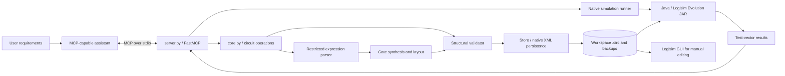

# Logisim Evolution MCP

A local MCP server that creates and edits **native `.circ` files**. Open the files in Logisim Evolution and edit the individual pins, gates, tunnels, wires, subcircuits, attributes and memory components normally.

Built and tested on Windows with Python 3.12, MCP SDK 1.30.0 and Logisim Evolution 3.8.0. Uses the official MCP Python SDK's v1 maintenance API, pinned below v2; `uv.lock` locks exact dependency versions.

## What you can build

Connect this server to an MCP-capable assistant, then ask:

> Use the Logisim MCP to create an editable four-bit adder as adder.circ and verify all input combinations.

> Create a circuit with inputs A, B and Sel, where Y = (A & ~Sel) | (B & Sel). Save mux.circ and test it.

> Inspect full_adder.circ, change the Sum output label to Result, and verify the updated circuit.

With the installation configuration below, generated files go in the `circuits` folder beside this README. Five ready-to-open examples are in `examples`: half adder, full adder, 2:1 multiplexer, 2-to-4 decoder, and four-bit adder. The adder uses separate one-bit pins A0–A3 and B0–B3, with bit 0 least significant.

## Installation

### Prerequisites

- Python 3.11 or newer; Python 3.12 was used for verification.
- [uv](https://docs.astral.sh/uv/getting-started/installation/) for reproducible dependency installation.
- Git to clone the repository.
- An MCP client with local stdio support, such as Codex.
- Optional for simulation: [Logisim Evolution](https://github.com/logisim-evolution/logisim-evolution/releases) and a Java runtime compatible with that release. The native checks here used Logisim 3.8.0 and Java 21.

No API key is required by this server. Your assistant's own model/account setup is separate. The server does not bundle Java or Logisim.

### 1. Download and install dependencies

Clone the repository:

```bash
git clone https://github.com/Irfan-1506/logisim_mcp.git
cd logisim_mcp
```

Install the locked dependencies, then optionally start the server manually:

```powershell
uv sync --frozen
uv run --frozen logisim-evolution-mcp
```

The second command starts the stdio server and waits for an MCP client. Silence is expected. Do not type chat messages into the terminal.

### 2. Connect Codex on Windows

From the repository folder:

```powershell
.\install-codex.ps1
```

The script installs locked dependencies and registers the `.venv` Python executable as a stdio MCP server named `logisim-evolution`. It sets the workspace to the repository's `circuits` directory. It refuses to replace an existing registration. The script requires `uv` and `codex` on PATH. If your PowerShell policy blocks scripts, use the equivalent explicit commands below instead of changing your machine's policy:

```powershell
$projectRoot = (Get-Location).Path
$serverPython = Join-Path $projectRoot '.venv/Scripts/python.exe'
$circuitRoot = Join-Path $projectRoot 'circuits'
codex mcp add logisim-evolution --env "LOGISIM_WORKSPACE=$circuitRoot" -- $serverPython -m logisim_mcp.server
```

For an explicit Java/JAR location, add `--env "LOGISIM_JAR=C:/path/to/logisim-evolution.jar"` and optionally `--env "LOGISIM_JAVA=C:/path/to/java.exe"` before `--` when registering. To intentionally replace an old registration, first run `codex mcp remove logisim-evolution`; existing circuit files are unaffected.

### 3. Connect on macOS/Linux or another MCP client

For Codex on macOS/Linux, after `uv sync --frozen`:

```bash
codex mcp add logisim-evolution \
  --env "LOGISIM_WORKSPACE=$PWD/circuits" \
  --env "LOGISIM_JAR=/absolute/path/to/logisim-evolution.jar" \
  -- "$PWD/.venv/bin/python" -m logisim_mcp.server
```

Windows was the tested host platform. The Python implementation is portable, but macOS/Linux native simulation has not been verified here. Logisim 3.8 needs access to a desktop/display; use an appropriate virtual display when running its native tests on Linux CI.

For clients using `mcpServers` JSON, adapt [mcp-config.example.json](mcp-config.example.json). Replace every placeholder with an absolute path. On macOS/Linux use `.venv/bin/python`; on Windows use `.venv/Scripts/python.exe`. MCP clients may launch servers from a different working directory, so relative command paths are unreliable.

### 4. Reload and verify

Restart your MCP client or reload its servers. In Codex, `codex mcp get logisim-evolution` should show an enabled stdio server. Ask the assistant to call `component_catalog`, then:

> Use create_example to create full_adder.circ with example full_adder and verify true. Report simulation.passed and the file path.

Open the returned file in Logisim Evolution. It contains individually editable native components. A successful file save alone does not imply a successful simulation; check the returned `simulation` field.

### Configuration

Environment settings:

| Variable | Purpose |
|---|---|
| `LOGISIM_WORKSPACE` | Root folder for projects. Tools only access `.circ` paths inside this folder. Defaults to `./circuits`. |
| `LOGISIM_JAR` | Installed Logisim Evolution JAR used for simulation. Auto-detects the standard Windows installation. |
| `LOGISIM_JAVA` | Java executable; defaults to `java`. Use the Java version required by your installed Logisim. |

Circuit generation and editing work without Java. Simulation requires Java and Logisim; version 3.8 test-vector mode also requires a desktop session (on a Linux CI machine use a virtual display). Newer Logisim releases have not been verified by this project.

## Tools

| Tool | Purpose |
|---|---|
| `list_projects` | Find project files in the workspace |
| `component_catalog` | Discover libraries, native names, edit schema and verified gate port offsets |
| `create_project` | Create a blank project |
| `inspect_project` | Inspect components, wires, native attributes and file revision |
| `read_project_xml` | Read the complete native XML |
| `import_project_xml` | Save/import native XML, including advanced component attributes |
| `edit_project` | Apply a batch of component, wire and circuit changes atomically |
| `validate_project` | Check structural validity |
| `synthesize_logic` | Generate and optionally simulate Boolean logic |
| `create_example` | Generate a standard circuit with optional exhaustive verification |
| `run_test_vectors` | Run actual Logisim test vectors and report passed/failed counts |

Also exposes the `logisim://guide` resource and `design_circuit` prompt.

## Boolean synthesis

Example tool arguments:

```json
{
  "path": "full_adder.circ",
  "inputs": ["A", "B", "Cin"],
  "outputs": {
    "Sum": "A ^ B ^ Cin",
    "Cout": "(A & B) | (Cin & (A ^ B))"
  },
  "verify": true
}
```

Supports `~` or `not`, `&`, `|`, `^`, parentheses and constants `0`/`1`. Parenthesize expressions explicitly. Names must be unique identifiers beginning with a letter. Expressions are parsed using a restricted AST, never evaluated as Python code. Maximum 12 inputs and 32 outputs. Each bit is a native one-bit pin. Repeated expressions share gates; labeled native tunnels connect nets without crossing wires. Generation does not minimize logic expressions or synthesize clocked logic from HDL.

With `verify=true`, all input combinations are simulated against the expression-derived truth table. This checks the generated wiring against the expression; the user must still supply the correct intended expression. Simulation results are separate from file creation: a simulation failure leaves the created project available for debugging. The return value includes the test-vector text.

## Editing existing projects

Copy your `.circ` into the configured workspace, or use `import_project_xml`. Inspect it first, then supply its SHA256 with your changes:

```json
{
  "path": "project.circ",
  "expected_sha256": "SHA256_FROM_INSPECT_PROJECT",
  "operations": [
    {"action": "add_component", "circuit": "main", "name": "AND Gate", "at": [300, 200], "attributes": {"inputs": 2, "size": 50, "facing": "east"}},
    {"action": "add_wire", "circuit": "main", "points": [[200, 180], [250, 180]]}
  ]
}
```

Supported operations: `add_circuit`, `set_main`, `add_component`, `set_attributes`, `move_component`, `remove_component`, `add_wire`, `remove_wire`. See `component_catalog` for all field examples. Native attributes set to `null` are removed. Components are selected by their unique anchor coordinate within a circuit. Paths and positions use a nonnegative 10-unit grid. Wires must be horizontal or vertical.

Moves and removals do not automatically repair wires. Include the required wire edits in the same batch. When creating subcircuit instances, use the circuit name as the component name and omit the library. Supply exact native attributes and explicit wiring for advanced components such as RAM, registers, multiplexers and splitters; their pin geometries are not automatically inferred. For external library components, supply the existing library ID.

Files are written atomically. Previous versions are retained as timestamped adjacent `.bak` files. Unknown XML elements and attributes are preserved semantically; indentation and XML comments need not be preserved. SHA256 checks detect changes made before saving but are not cross-application file locks. Reload a project in Logisim after changing it externally; avoid saving stale GUI contents over newer edits.

## Verification

```powershell
uv run --frozen python -m unittest discover -s tests -v
```

Tests cover MCP stdio discovery and calls, XML entity rejection, path restrictions, atomic edit rollback, backup creation, stale revisions, native XML preservation, recursive subcircuit rejection, expression validation, full-adder arithmetic, actual native gate simulation, and detection of deliberately incorrect test vectors. Native tests skip when no JAR is available. `verification.json` records native simulator results for the supplied examples, including all 512 combinations of the four-bit adder with carry input.

Structural validation checks XML, coordinates, wires and library/subcircuit references. It does **not** prove port connectivity, bus widths, valid arbitrary attributes, clocked behavior, or correct logic. Use native simulation for electrical checks. There is no universal guarantee for arbitrary circuits or third-party libraries.

## Architecture and system design

### Runtime boundaries



The assistant interprets natural language and selects tools. The server itself contains no LLM, remote model calls, database, web service, or GUI automation. It runs as a local child process of the MCP client. `main()` starts FastMCP with `transport="stdio"`. The MCP SDK manages protocol messages, tool discovery, parameter schemas and error responses; application code returns dictionaries or XML text. Keep stdout reserved for the protocol when extending the server.

### Code organization

```text
logisim-evolution-mcp/
├── src/logisim_mcp/
│   ├── __init__.py
│   ├── server.py                 # 11 MCP tools, resource, prompt, entry point
│   └── core.py                   # XML, persistence, synthesis, native simulation
├── tests/
│   ├── test_core.py              # Persistence, input checks, math, native gates
│   └── test_mcp.py               # Real client/server stdio round trip
├── examples/                    # Editable circuits and available vector files
├── install-codex.ps1             # Windows Codex registration helper
├── mcp-config.example.json       # Portable client configuration template
├── verification.json            # Sanitized native verification evidence
├── pyproject.toml                # Package metadata and executable entry point
├── uv.lock                       # Exact dependency resolution
└── README.md
```

| Module or function | Responsibility |
|---|---|
| `server.py` decorators | Publish tool schemas, descriptions, resource and prompt |
| `Store.path/read/inspect` | Resolve workspace paths, load XML, produce inspections and revision hashes |
| `Store.edit/write` | Apply edit batches, validate, back up and replace the file |
| `new_project/add_component/wire` | Construct native project, component and wire elements |
| `parse_expression/evaluate` | Restrict the expression language and calculate expected outputs |
| `synthesize` | Share repeated expression subtrees, place gates and create tunnel nets |
| `validate` | Check project structure, references, coordinates and subcircuit cycles |
| `find_jar/simulate` | Locate Logisim, execute test vectors and parse its result summary |

### Native data model

The source of truth is the `.circ` XML file on disk. The in-memory model is an ElementTree of that same file; there is no separate proprietary circuit representation to export or synchronize.

- `<project source="3.8.0" version="1.0">` declares the project format target.
- `<lib>` elements map library IDs to Wiring, Gates, Plexers, Arithmetic, Memory, I/O and Base.
- `<main name="...">` selects the main circuit.
- `<circuit name="...">` holds native circuit attributes, components and wires.
- `<comp name="..." lib="..." loc="(x,y)">` identifies a built-in/library component. A component without `lib` refers to a project subcircuit.
- `<a name="..." val="...">` stores a native attribute. Existing nested/custom XML is retained when making edits.
- `<wire from="(x1,y1)" to="(x2,y2)">` connects grid coordinates. Component coordinates are anchors, not bounding-box corners.

This direct representation is what makes the result editable in Logisim. Library component names are a convenience catalog, not a complete schema of every valid native attribute or port.

### Synthesis pipeline

1. Validate input/output identifiers, uniqueness and size limits.
2. Parse each expression with Python's AST parser and accept only declared names, one-bit constants, supported unary operators and bitwise binary operators.
3. Traverse expression trees bottom-up. Cache `ast.dump()` keys so structurally identical expressions share generated gates across outputs.
4. Place east-facing gates in columns of 12, using a 400-unit column pitch and 120-unit row pitch. Inputs and outputs use separate columns with 80-unit pin spacing.
5. Create labeled native tunnels and short orthogonal wires at verified gate pin offsets. Generated net names begin with `__mcp_net_`; user identifiers cannot start with an underscore.
6. Enumerate `2^n` input combinations in the declared input order. Evaluate outputs in mapping order and format Logisim vectors.
7. Validate and save the `.circ`; optionally run those vectors through native Logisim.

This layout favors predictable connectivity and editable output. It is not a routing optimizer or a Boolean minimizer. Large expressions can make wide diagrams, and long labels may require manual cosmetic adjustment. Truth-table enumeration scales exponentially, which is why the automatic input limit is 12.

### Edit transaction and persistence

```mermaid
sequenceDiagram
    participant Client as MCP client
    participant Server as edit_project
    participant Store as Store
    participant Disk as Workspace
    Client->>Server: path, operations, expected_sha256
    Server->>Store: acquire in-process lock and read
    Store->>Disk: load native XML
    Store->>Store: apply all operations in memory
    Store->>Store: validate project and check revision
    alt invalid operation or stale hash
        Store-->>Client: tool error; original file retained
    else valid batch
        Store->>Disk: copy previous version to timestamped .bak
        Store->>Disk: write temporary file in destination directory
        Store->>Disk: os.replace temporary file onto .circ
        Store-->>Client: path, sha256, backup, validation
    end
```

The module-level reentrant lock serializes mutation paths and native simulations within one server process. A long simulation can therefore delay edits. This design is intended for a local assistant working on files, not a multi-tenant service. Multiple independent server processes and the Logisim GUI do not share this lock. An optional hash detects a file revision that already changed before writing, but there is still a race with an external writer after the check. Atomic replacement prevents partially written files from being observed; it is not a crash-durable database transaction. Backups are retained until manually removed.

If an operation fails before saving, no partial batch is committed. Repeated `add_wire` calls suppress identical segments; component insertion is not generally idempotent. Do not blindly retry a whole mutation after a transport interruption: inspect the project first.

### Simulation design and result semantics

The runner writes vectors into a temporary directory and invokes an argument-list subprocess equivalent to:

```text
java -jar <LOGISIM_JAR> --no-splash --locale en --test-vector <circuit> <vectors.txt> <project.circ>
```

It does not invoke a shell. English locale makes summary parsing predictable. Passing requires all of these conditions: a recognized `Passed: N, Failed: M` summary, `N > 0`, `M == 0`, and process exit code zero. Missing summaries are not treated as success. The runner returns the last 20,000 characters of combined stdout/stderr and removes its temporary directory afterward. The subprocess timeout defaults to 60 seconds and is configurable from 1 to 120 seconds for `run_test_vectors`.

`synthesize_logic` saves the artifact before simulation. It catches simulation startup/timeout errors and returns them in `simulation`, allowing the user to inspect the saved circuit. `run_test_vectors` reports invocation errors as tool errors. A simulator failure does not automatically undo or delete a project.

### Trust boundaries and limits

This server is intended for a trusted local MCP client and trusted Logisim installation. It does not implement network authentication because it exposes only stdio. The Python process has the host user's OS privileges; workspace path checking is an application guard, not an OS sandbox. External libraries referenced by imported projects can still be resolved by Logisim; only simulate projects and libraries you trust.

| Guard | Implemented limit or behavior |
|---|---|
| File paths | Resolved `.circ` paths must stay within the configured workspace |
| XML reads/imports | 20,000,000-byte limit; protected XML parsing; imports explicitly reject DTDs |
| Boolean language | Restricted AST, no `eval`, calls, attribute access or arbitrary Python |
| Expressions | At most 4,096 characters and 512 AST nodes per expression |
| Synthesis | 1–12 inputs and 1–32 outputs |
| Edit batch | 1–5,000 operations |
| Coordinates | Integer multiples of 10, from 0 to 100,000 |
| Vectors | At most 1,000,000 string characters in the current runner |
| Native execution | Fixed command structure, timeout, captured output |

The size limits are not a full resource quota. Native child processes and XML/library loading retain their own behavior. The server does not check every electrical rule or automatically watch/reload the GUI.

## Troubleshooting

| Symptom | What to check |
|---|---|
| Tools do not appear | Reload the MCP client; check `codex mcp get logisim-evolution`; verify absolute executable paths and run `uv sync --frozen` |
| Server waits silently in terminal | Expected: stdio servers wait for MCP protocol input |
| `File exists` | Inspect the existing project; set `overwrite=true` only when replacement is intended |
| `File changed since inspection` | Inspect again and use the new hash; reconcile external changes before editing |
| `Project path must be a .circ file...` | Use a `.circ` path under `LOGISIM_WORKSPACE`; copy/import external files first |
| `Set LOGISIM_JAR...` | Set the actual JAR path in the MCP server environment and reload the server |
| Java executable missing | Install a suitable Java runtime or set `LOGISIM_JAVA` to its absolute executable path |
| `HeadlessException` or no native summary | Logisim 3.8 test-vector execution needs desktop support; do not force Java headless mode |
| Simulation fails or times out | Inspect returned output, circuit name, pin labels, vectors and library availability; simplify or increase timeout within the limit |
| GUI shows old contents | Reload the `.circ` after external edits; avoid overwriting it from an older GUI session |
| Tool succeeds but `simulation.passed` is false | Saving worked; electrical verification did not. Inspect the separate simulation result |

## Development and extension

Use `uv sync --frozen` and the unittest command above. Core functionality can be exercised without starting MCP by importing `logisim_mcp.core`. `test_mcp.py` starts a real subprocess using the same interpreter, performs the protocol handshake, discovers tools, calls them and checks error responses.

To add a native component convenience wrapper, first verify its exact native name, attributes, orientation and port offsets against the target Logisim version. Keep XML/geometry logic in `core.py`, expose a small typed wrapper in `server.py`, and verify connectivity with native test vectors where applicable. Adding a name to `CATALOG` alone does not establish correct wiring. When changing dependencies intentionally, regenerate and commit `uv.lock` and rerun tests.

Current non-goals: HDL import/synthesis, sequential-circuit synthesis, automatic bus routing, arbitrary component port inference, logic minimization, GUI live synchronization, HTTP hosting, multi-user collaboration and automatic backup retention. Advanced native components can be represented through explicit XML/edits, but their behavior requires separate verification.

## Sources

- [Official MCP Python SDK v1 documentation](https://py.sdk.modelcontextprotocol.io/v1/)
- [Logisim Evolution source and releases](https://github.com/logisim-evolution/logisim-evolution)
- [Native gate port geometry](https://github.com/logisim-evolution/logisim-evolution/blob/v3.8.0/src/main/java/com/cburch/logisim/std/gates/AbstractGate.java)

This is an independent integration, not an official Logisim Evolution project.
